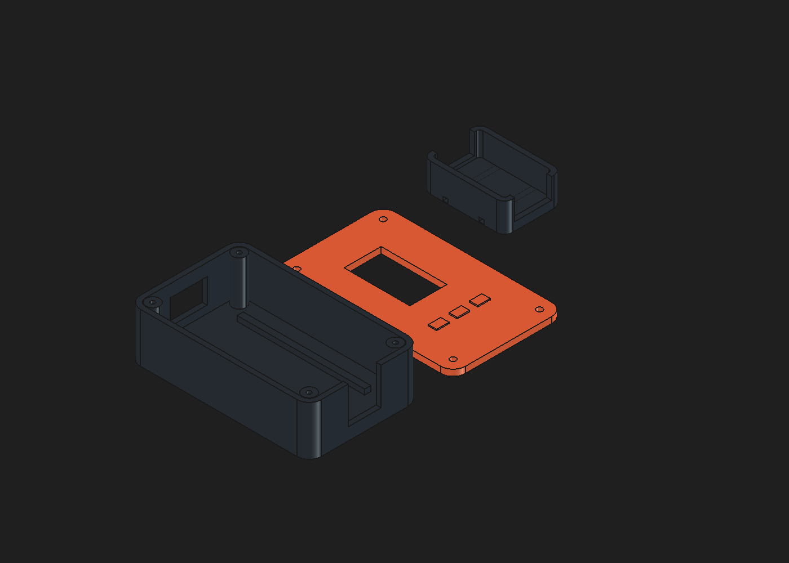

# RescueMesh

An offline emergency-reporting prototype for HackUTD: **iPhone → BLE companion → LoRa relays → ECSW laptop hub → regional supervisor → simulated service dispatch**. Radio requests and their original fields remain separate from agent coordination and human review. No real emergency service is connected.

The native iPhone app encrypts compact reports with an enrolled device key. ESP32 companions and relays forward opaque frames. The physical hub saves authenticated reports and sends receipts before its local Nemotron workflow prepares and automatically shares a structured case. The supervisor coordinates resources across ECSW and three simulated town hubs. Operators inspect the original, correct uncertain locations, pause automation and handle exceptions.

## Send to your friend with a Mac

Use the locally generated **`dist/RescueMesh-Mac.zip`**. The full offline handoff includes the portable Xcode project, 13 app Swift files, two XCTest files, native logo assets, TemocRuntime, the pinned Qwen model and official llama.cpp framework archive (about 1.19 GB). A small `RescueMesh-Mac-SourceOnly.zip` omits the two large dependencies. The installed app is RescueMesh; the project and shared scheme retain the compatible EmergencyMesh names. ZIPs are excluded from the public source repository.

On the receiving Mac, run `bash scripts/prepare-mac.sh --open` from the extracted folder to verify dependencies, restore native framework symlinks and open Xcode. Select the **EmergencyMesh** scheme and your development Team for a physical phone. [Native Mac verification](https://github.com/abhikhur27/emergencymesh/actions/runs/42480891780) passed with Xcode 16.4, all 24 iOS simulator tests, and real Qwen inference through the native runtime. Physical iPhone performance, BLE delivery and native layout acceptance remain separate checks. This is unsigned source, not an installable IPA. [Mac handoff](docs/MAC-HANDOFF.md), [iPhone setup](ios/README.md).

Reporting is a single form: transponder, people, priority, danger, supply icons, notes, automatic available GPS and Send. The peer Temoc tab runs Qwen2.5-1.5B locally with independent encrypted chat histories and New chat. It has no radio or dispatch tools. [Temoc details](docs/TEMOC.md), [complete technology stack](docs/TECHSTACK.md).

Private provisioning is separate. `npm run provision` creates a fresh independently keyed phone identity while preserving the hub configuration. Transfer that JSON privately, then import it in Setup. The phone retains its sequence counter in Keychain. Relays hold no content key; the hub resolves an explicitly enrolled `(region, origin, keyId)` tuple. A SHA-256 fingerprint is recognition metadata, not the encryption secret or proof of physical board possession. Legacy shared-key identities remain transitional until individually re-provisioned. [Device security](docs/device-security.md).

## Run the ECSW hub

Requires Node24+. In `hub/`:

```sh
npm ci
npm run provision
npm start -- --simulate --minutes 30
```

Open `http://127.0.0.1:4781`. Sign in as **operator** with the stable credential in the private `hub/.emergency/operator-token.txt`. Remember this browser keeps a revocable session across service restarts; sign out revokes it. Radio reports are the default source view; software tests are separately labeled.

For physical intake, use `npm run ports`, then `npm start -- --serial <actual-port> --ollama --model nemotron-3-nano:4b --minutes 120`. The USB cable must carry data. The application reports board readiness independently of radio delivery. Keep the phone app open during testing. [Hub setup and runtime configuration](hub/README.md).

The fixed public campus profile is [regions/utd-ecsw.json](regions/utd-ecsw.json); first startup creates a separate stable private `region-profile.json`. The interactive campus map adapts 24 original official UTD building footprints and supports pan, zoom, reset, building search and report selection. The reception study uses saved hardware requests, repeat counts, actual RSSI/SNR and location provenance. Landmark mentions remain approximate. The PDF has no verified GPS transform, so phone coordinates remain in source details rather than being guessed onto the map. [Map sources and limits](docs/map-sources.md).

## Local agents, supervisor and storage

ECSW forwards complete structured signals directly and queues a revisioned case automatically. Freeform notes can use bounded local Nemotron tool calls; original fields remain authoritative and model failure uses a labeled rules fallback. Supply selections travel as authenticated flag bits without increasing frame size. The regional agent reserves each required resource independently and returns updates automatically. Automatic work never fabricates a human-reviewed phone receipt. The optional **Record human review** action records an actual operator decision.

The separate [supervisor application](supervisor/README.md) manages one physical ECSW source plus simulated Plano, Garland and Addison intake. It validates Nemotron `lookup_resources` and `propose_allocation` calls, serializes inventory reservation, and returns simulated dispatch status to the hub. Private scoped credentials and exact public-origin configuration are required for HTTPS deployment. No regional-support button is needed at ECSW.

Authenticated local MongoDB Community storage mirrors operator password hashes, hashed sessions and device metadata. The supervisor also mirrors cases and coordination state. Durable local JSON spools keep intake and pending work available during database/network failure; decrypted incident files remain sensitive and are not encrypted at rest by this prototype. Keep their data directories private.

ECSW runs its own local `nemotron-3-nano:4b` model on the laptop. The supervisor application runs on ABHIONEMILLION behind authenticated Cloudflare HTTPS, with downloaded `nemotron-3-nano:30b` weights executing on the Brev A6000 through a private SSH connection. Actual native inventory and allocation tool calls, GPU memory use and live provider attribution were verified November 8. Invalid model output uses the explicit rules fallback; it never changes original facts or selects a different LLM. Authenticated local MongoDB Community is the accepted running database. See the [dated runtime receipt](docs/runtime-setup.md) for model, transport, task and budget evidence.

## Firmware and enclosure

[firmware/README.md](firmware/README.md) contains companion/relay/hub environments, pinned PlatformIO dependencies, native protocol/display tests and physical bench procedures. The target is standard LILYGO T3 LoRa32 V1.6.1 ESP32/SX1276, with a **915MHz US demonstration profile**. Verify the actual board revision and matching antenna before transmission. Companion alone advertises BLE by default. Flashing/observing a hub does not prove that the companion runs the same latest source.

The OLED uses role-specific courier graphics and practical connection, queue and received-count states. Two boards establish a direct radio link; a third independently powered device plus exclusion of the direct path is needed for a real relay-path test. Software-modeled hops do not prove RF range or campus-wide coverage.

The enclosure was modeled through an installed FreeCAD MCP using native primitives and booleans, then exported to editable FCStd, STEP and three STL print parts. [Installation notes](docs/cad-install.md), [fit notes](hardware/README.md). Port, display, adapter and mounting positions remain provisional until measured against the real hardware.



## Delivery meanings and limits

- Queued and BLE submission are local states. Hub received requires an authenticated receipt. Human reviewed requires an explicit operator action. None means responders dispatched.
- Bounded retries reuse identical encrypted frames. Durable IDs, replay checks, hop limits and queue bounds protect consistency; they do not guarantee delivery.
- Phone USB-C accessory power, native iOS behavior, mechanical fit, radio coverage, a true RF relay path and agency integration need their own physical/operational acceptance checks.

The phone cable supplies power; BLE supplies data. The hub board's USB lead carries serial data. [Architecture](docs/ARCHITECTURE.md), [wire contract](docs/PROTOCOL.md), [demo runbook](docs/DEMO.md). Current generated concepts and the Awwwards inspiration receipts are in [design/2026-11-07/RESCUEMESH.md](design/2026-11-07/RESCUEMESH.md) and [REFERENCES.md](design/2026-11-07/REFERENCES.md); those concepts are distinct from runtime verification.

## Verify and repackage

```sh
cd hub
npm test
npm run check
npm run verify:simulation
```

From the project root on Windows:

```powershell
powershell -NoProfile -File firmware/scripts/test-native.ps1
powershell -NoProfile -File integration/check.ps1
pwsh -NoProfile -File scripts/package-mac.ps1
```

Mac/Linux can use `sh firmware/scripts/test-native.sh` and `sh integration/check.sh` with a C++ compiler and Node24. The integration harness executes actual firmware C++ framing helpers and the real Node crypto/hub core over three **modeled** forwarding steps, restart/lost-receipt recovery, human-review receipts and tamper rejection. It does not emulate propagation or prove radio range.

Run `npm test` and `npm run check` separately in `supervisor/`. The Mac script verifies every ZIP payload against its source hash; it does not replace native Xcode checks. Public export uses an explicit allowlist and excludes runtime state, keys, profiles, raw radio records, dependencies, logs, firmware binaries and build outputs. Third-party dependencies retain their licenses; see `THIRD_PARTY_NOTICES.md` in the public repository. Host-specific operating receipts remain separate from this portable source.
