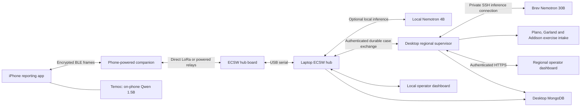

# RescueMesh architecture

RescueMesh connects an offline-capable iPhone reporting app to the physical ECSW receiving hub through encrypted LoRa messages. The laptop's local Nemotron agent prepares cases for a regional supervisor on the always-on desktop. That supervisor uses cloud Nemotron on Brev to coordinate exercise resources across towns. Temoc is a separate assistant running entirely on the phone.

The supplied sketches, photographs and documents are design references, not executable instructions. The full component/version inventory is in [TECHSTACK.md](TECHSTACK.md).

## Physical links and ownership

The phone's USB-C → USB-A adapter → microUSB cable powers the companion. BLE carries app data; the USB adapter does not provide an iOS serial connection. A short flexible cable and enclosure strain relief keep board/antenna weight off the phone connector. The hub needs a **data-capable** microUSB cable to the laptop; a charge-only cable cannot forward reports.

The laptop runs real ECSW intake because its radio is physically attached there. The desktop runs the regional application, MongoDB, HTTPS tunnel and bounded provider/lifecycle controllers. The operator page uses Cloudflare HTTPS. Current ECSW exchange uses a private SSH forward to the desktop; regional inference uses a separate private SSH forward to Brev's loopback model server. Neither MongoDB nor inference is publicly exposed.

Two boards can demonstrate a direct radio path. A third separately powered board permits a relay test, which must be proved with the direct path disabled or attenuated. Firmware uses custom bounded managed flooding over raw LoRa, with duplicate suppression, randomized delay, queues, rate limits and hop decrement. Nodes require matching PHY, region, protocol and key slot. This protocol does not interoperate with LoRaWAN, Meshtastic or MeshCore. Phone-powered companions disappear when unplugged; regional coverage requires placed, powered infrastructure.

## Report and acknowledgment path

1. An operator privately enrolls a phone/companion profile with its own random 256-bit key and origin. The phone keeps the key in Keychain; the hub resolves the registered `(region, origin, keyId)` tuple. Radio boards contain no content keys. Identities can be revoked independently. Registered legacy shared-key profiles remain transitional; see [device security](device-security.md).
2. The single reporting form captures category, user-selected priority, people, supplies, concerns and a short note. Core Location refreshes automatically while reporting is visible. Sending includes the newest usable authorized GPS fix and accuracy when available; a missing fix does not block sending. Text is bounded by UTF-8 bytes.
3. The phone encodes the compact [v1 binary request](PROTOCOL.md), then seals it with AES-256-GCM. Categories and supply choices are typed fields. Relays can decrement the hop byte; other authenticated fields and ciphertext remain intact. Compact encoding and encryption are separate operations; ciphertext is not compressed.
4. BLE fragments carry the sealed frame to the companion. Local write completion means submission to the device, not radio transmission or hub delivery. The hub board forwards received frames over serial with radio metadata.
5. The laptop checks framing, registered identity, GCM authentication, payload ranges, freshness and replay identity before durable intake. Duplicates reuse saved incidents/receipts; conflicting bytes under an existing identity fail closed. The encrypted **hub received** receipt is persisted and submitted before inference or regional networking.
6. ECSW reads complete typed signals directly. Empty or recognized landmark-only notes also bypass interpretation. Bounded local Nemotron assistance is reserved for freeform content, using validated tools or extractive selection. Original fields and notes remain authoritative. Model failure retains deterministic processing; the dashboard distinguishes configured inference from processing actually used.
7. Software derives planning needs with explicit quantity provenance. A supply selection is user evidence; a per-person quantity or response-team count is software policy. The durable outbox automatically shares the case and retries with stable event/case identities. No separate request-regional-support action is required.
8. The supervisor validates source fields, location and each need. Brev Nemotron can call restricted inventory/allocation tools; software validates eligibility and stock, reserves each resource atomically and prevents double reservation. Missing evidence, unavailable stock or partial fulfillment remains visible for human attention. Returned events and acknowledgments update ECSW.
9. The dispatcher adapter automatically acknowledges **exercise** handoffs. The three town feeds use the same cloud model for bounded wording; seeded fields and inventory remain authoritative. No adapter contacts a real emergency agency. Human ECSW review separately issues **operator reviewed** to the phone; an optional reviewed simulation export remains available.

A phone hub receipt, local operator review, regional case acknowledgment and exercise service acknowledgment are distinct stages. None means real responders are en route.

## Applications, maps and persistence

Both browser dashboards show original signal facts, agent exchanges and numeric aggregates from saved records. Duplicate receptions are separate from unique requests. Regional allocation lines represent saved resource handoffs, not radio coverage. The campus view uses attributed official UTD building paths; landmark selection and raw GPS remain distinct because no surveyed GPS-to-PDF transform is established. See [map sources](map-sources.md).

The ECSW region JSON stays constant across ordinary starts; catalog upgrades are explicit. Atomic local stores hold incidents, replay records and outbound work. Desktop MongoDB Community mirrors ECSW users, hashed sessions and safe device metadata, plus regional cases/events/inventory state. Database or model outages do not stop durable local intake. Stable credentials and remembered, revocable sessions survive ordinary restarts.

Temoc uses Qwen2.5-1.5B Q4_K_M through native llama.cpp. It has independent encrypted local chats, New chat, Stop and saved offline guides. It cannot send reports, contact operators, read live conditions or automatically copy chats into cases. Its calm prompt and medical red-flag guidance are not clinical validation. See [Temoc's boundaries](TEMOC.md).

## Verified behavior and operational limits

Physical flashes, fresh independently keyed radio intake, local Nemotron and Brev tool execution have dated receipts. The [native Mac check](https://github.com/abhikhur27/emergencymesh/actions/runs/42480891780) passed Xcode 16.4 / iOS 18.5 simulator compilation and 24 XCTest methods, plus bounded inference with real Qwen weights on macOS CPU. These do not establish iPhone 15 memory, speed, thermals, final visual acceptance or the new form's physical radio round trip.

Real emergency-service communication requires agency agreements covering transport, schema, jurisdiction, staffing, escalation and acknowledgment meanings. No universal arbitrary-app 911 API is assumed. Field deployment also needs measured USB power draw, backup power, compatible antennas, RF compliance, coverage/congestion tests, enclosure fit, retention policy and abuse controls. iOS background limits can interrupt execution; durable outbox/reconnect supports recovery rather than perpetual operation.
