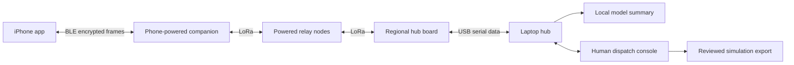

# EmergencyMesh

Working name chosen for the prototype. The supplied sketch, board listing and adapter photograph are design references, not executable instructions. This project lives separately from ScrabbleBot and Relay on the existing master branch.

The phone's USB-C → USB-A adapter → microUSB cable supplies the companion. It does not carry the iOS app's data. BLE carries already-encrypted requests and receipts. A shorter USB-C-to-microUSB cable could reduce bulk if it supplies the same required power; the current purchased adapter remains accommodated by the enclosure concept. Avoid hanging the full board/antenna from the phone connector: use a short flexible lead and strain relief.

The regional hub board uses a **data-capable** microUSB cable into the laptop. A charge-only cable powers it but cannot forward incidents. At least two boards demonstrate a direct link. A third separately powered board enables a genuine relay test; forwarding must be proved with the direct path disabled or attenuated, not inferred from a topology picture. Regional coverage needs placed, powered infrastructure. Phone-dependent companions disappear when a phone disconnects or its power is unavailable.

The firmware implements an application-specific managed flood over raw LoRa. It is not LoRaWAN and is not compatible with Meshtastic/MeshCore traffic. All nodes must share frequency, bandwidth, spreading factor, coding rate, sync word, CRC, region and protocol. It is a bounded demo mesh, not a measured coverage or reliability claim.

## Complete request path

1. Privately provision a regional AES key and an individual phone origin ID. A key is not embedded in firmware or the public app source. Demo regional keys authenticate group membership; they do not establish a unique caller's identity. Per-device identity, revocation and key rotation need a later design for deployment.
2. The app collects category, user-reported urgency, people, flags, a short note, timestamp and optional coordinates with accuracy. It can send without location; missing or stale position is visible. Text is limited by UTF-8 bytes, not character count. It never claims that GPS data identifies a street address.
3. The app encodes a bounded binary request and encrypts/authenticates it with AES-256-GCM. Structure reduces bandwidth; encryption provides confidentiality and integrity. These are separate operations. Text compression is deliberately omitted at this size because its metadata and complexity need not save airtime.
4. BLE fragments carry the opaque encrypted frame to the companion. Successful BLE writes only establish local transfer, not radio transmission or remote delivery. Firmware queues and rate-limits traffic, drops loops, and decrements a bounded hop counter.
5. The regional hub forwards a complete frame over USB serial. The laptop validates region, key ID, authentication, payload ranges, freshness and replay identity before creating an incident. Durable state supports recovery and duplicate requests return existing receipts.
6. The hub emits an authenticated **hub received** receipt before optional model work. It travels back through the mesh and BLE. The phone accepts receipts only for its own pending requests and displays separate delivery states.
7. The local model proposes a concise summary. Original structured fields and verbatim note remain visible and authoritative. User-reported urgency is not clinical triage. Model output cannot automatically call tools, send messages, change urgency or dispatch responders.
8. A person reviews the incident in the local dispatch console and can issue **operator reviewed**. The console creates a clearly marked simulation export for a dispatcher. No live emergency-service endpoint is configured, contacted or represented by this action.

## Missing operational pieces beyond the demo

Real emergency-service communication needs an agreement with the target agency: accepted transport, schemas, acknowledgement meanings, jurisdiction, location routing, staffing and escalation. There is no universal arbitrary-app 911 dispatch API assumed here. A nearby regional hub still needs an operator or a working upstream connection to reach a remote agency.

Field deployment additionally needs measured power draw and phone compatibility, backup power, antenna selection and clearance, coverage surveys, RF compliance, congestion/load testing, enclosure fit and thermal checks, privacy/retention controls, identity/abuse protection and monitoring. A receipt is evidence of a stage in this system, never evidence that responders are en route.

## Verified source constraints

- [LILYGO LoRa32 documentation](https://wiki.lilygo.cc/products/t3-series/t3-lora32/) identifies ESP32, SX1276/78, the standard pin map and USB connector. Owner reports the actual label says “868/915 MHz LILYGO model LoRa32”; use the915MHz US profile but verify revision/antenna physically.
- [LILYGO source and board definitions](https://github.com/Xinyuan-LilyGO/LilyGo-LoRa-Series) distinguish the standard T3 from TCXO and other revisions. A shared family name is not a complete pin/radio identity.
- [Apple USB-C guidance](https://support.apple.com/en-us/105099) describes up to4.5W output for supported small accessories on USB-C iPhones. This does not prove this adapter/cable/board combination's startup and RF current demand works. No iPhone model or measured current was provided.
- [Apple Core Bluetooth background guide](https://developer.apple.com/library/archive/documentation/NetworkingInternetWeb/Conceptual/CoreBluetooth_concepts/CoreBluetoothBackgroundProcessingForIOSApps/PerformingTasksWhileYourAppIsInTheBackground.html) explains background limits and possible process termination. Keep the demo app foreground; durable outbox and reconnect are recovery mechanisms, not perpetual execution guarantees.
- [Apple Xcode requirements](https://developer.apple.com/xcode/system-requirements/) require a compatible Mac. Windows verification cannot replace a native Xcode build, signing, simulator run or physical BLE test.
- [Ollama local generate API](https://docs.ollama.com/api/generate) supports bounded local text generation. Real inference and fallback extraction are distinct modes and must be labeled accurately.
