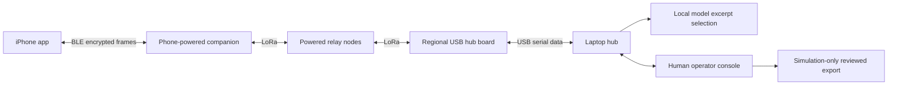

# Architecture

The companion connects to the phone over BLE; its cable supplies power. A hub board uses a data-capable USB cable to reach the laptop. Relays need independent power. Only the companion advertises the phone service by default, preventing a phone from accidentally attaching to the USB hub instead.

## Request path

1. The laptop privately creates a regional 32-byte AES key and an individual phone origin ID. The app stores its profile in Keychain. Firmware has no regional key. Group-key possession permits impersonation; this demo does not establish per-user identity or revocation.
2. The app collects category, user-reported urgency, people, flags, a short note, timestamp and optional recent coordinates with accuracy. It can send without location. The note limit is 120 UTF-8 bytes.
3. A binary encoder produces a bounded payload. AES-256-GCM provides confidentiality and integrity. Structure reduces bandwidth; encryption is a separate operation. The largest request is 184 bytes including encryption overhead.
4. BLE fragments carry the opaque frame to the companion. Local BLE completion is not radio delivery. Firmware bounds its queues, forwarding hops, duplicate cache and radio rate.
5. The hub board forwards a frame over serial. The laptop validates framing, configured region and key ID, authentication, semantic fields, timestamp and replay identity before creating a durable incident. Identical retries resend the existing receipt rather than creating another incident.
6. The laptop persists and submits an authenticated **hub received** receipt before optional local inference. The phone accepts receipts only for known requests and never regresses an operator-reviewed state.
7. Local Ollama selects existing note sentence indices. Strict validation reconstructs displayed excerpts from exact source spans. Category, urgency, people and location come directly from original structured fields. An outage uses a labeled deterministic fallback; original reports remain authoritative.
8. A person reviews the report and may send **operator reviewed**. A reviewed export is explicitly marked simulation with no services contacted. A real dispatch agency needs an agreed workflow and integration.

## Mesh scope

This is application-specific managed flooding over raw LoRa. It is not LoRaWAN and does not interoperate with Meshtastic or MeshCore traffic. Every radio must share frequency, bandwidth, spreading factor, coding rate, sync word, CRC and protocol profile.

Two radios establish a direct link. A true relay demonstration requires another powered radio and evidence that the direct path was excluded. Software forwarding tests do not establish propagation, range, congestion tolerance or regulatory compliance.

Phone-powered companions disappear when their power is lost. Regional infrastructure needs planned placement, backup power and a reachable operator or upstream channel. A received or reviewed receipt does not mean responders are en route.

## Platform constraints

- [LILYGO LoRa32 hardware](https://wiki.lilygo.cc/products/t3-series/t3-lora32/) and [upstream source](https://github.com/Xinyuan-LilyGO/LilyGo-LoRa-Series) distinguish the standard T3 from TCXO, S3 and other variants.
- [Apple USB-C guidance](https://support.apple.com/en-us/105099) describes supported accessory power. The actual phone, adapter, cable and board combination still needs testing under startup and radio bursts.
- [Core Bluetooth background behavior](https://developer.apple.com/library/archive/documentation/NetworkingInternetWeb/Conceptual/CoreBluetooth_concepts/CoreBluetoothBackgroundProcessingForIOSApps/PerformingTasksWhileYourAppIsInTheBackground.html) is limited. Keep the demo app foreground; protected outbox and reconnect support recovery rather than perpetual execution.
- [Xcode requirements](https://developer.apple.com/xcode/system-requirements/) require a compatible Mac. Source parsing on Windows is not an Apple SDK build or native test run.
- [Ollama API](https://docs.ollama.com/api/generate) provides local inference. Configure the runtime for local use; no runtime or model is bundled here.
