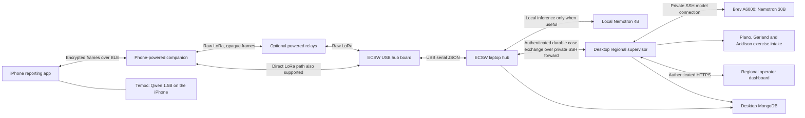

# RescueMesh technology stack

Source and deployment inventory, November 8, 2026. RescueMesh has three applications: the iPhone app, the physical ECSW receiving hub on the laptop, and the regional supervisor on the always-on desktop. The supervisor uses a separate Brev GPU for inference. Temoc runs on the phone itself.

## How the components connect

The phone's USB cable supplies power to the companion; BLE carries app data. The laptop's USB cable carries both hub power and serial data. The Internet-facing HTTPS page is the regional operator dashboard. The current ECSW-to-supervisor connection and supervisor-to-Brev inference connection use private SSH forwards; the diagram does not imply that those machine calls traverse the public dashboard URL.

## Applications and inference

| Component | Technologies and pinned versions | Responsibility |
| --- | --- | --- |
| Native phone app | Swift 5 language mode, SwiftUI, iOS 17 minimum; Foundation and Combine | Reporting, transponder connection, request history, private profile setup and Temoc tabs. Uses the supplied RescueMesh PNG/PDF assets in an Xcode asset catalog and native SF Symbols. |
| Single-screen report | SwiftUI controls; typed category, priority, people, supply selection and UTF-8 notes | One reporting form goes directly to sending and receipt status. Food, water, medicine and power can be selected together. Original fields are preserved through the hub workflow. |
| Phone location | Core Location, foreground when-in-use authorization | Automatically refreshes while reporting or a reply conversation is visible. At send time it selects the newest valid fix within 120 seconds, including available manager-cached GPS, and includes accuracy. A missing fix does not block sending. |
| Phone radio link | Core Bluetooth, Nordic UART Service (NUS) | Writes encrypted fragments with response and subscribes for encrypted receipts. BLE write completion and a hub receipt remain separate states. |
| Phone cryptography and storage | CryptoKit AES-256-GCM and SHA-256; Security Keychain; Codable JSON | Device-only keys, persisted sequence counters and an encrypted durable outbox. App files are excluded from backup. Clearing report history preserves counters to avoid replay-identity reuse. |
| Temoc model | Official `Qwen/Qwen2.5-1.5B-Instruct-GGUF`, Q4_K_M; revision `91cad51170dc346986eccefdc2dd33a9da36ead9` | A separate offline assistant for calm general preparedness and support. Exact model file: 1,117,320,736 bytes, about 1.12 GB decimal. Model size is not a measured RAM requirement. |
| Temoc runtime | Official llama.cpp `b5046` XCFramework, local Swift package `TemocRuntime`; Metal and Accelerate | Real in-process native inference through the `llama` C API. iOS devices request Metal offload; simulators use CPU. One serial actor owns a memory-mapped model, with a 2,048-token context and at most 320 generated tokens. |
| Temoc history and guidance | Separate AES-GCM archive and Keychain service; bounded Codable chat records | Up to 20 separate chats and 80 messages per chat. New chat resets model context while retaining earlier conversations. Stop, tab switching, backgrounding and memory pressure cancel inference and release the model. Included attributed guides remain available without model weights. |
| ECSW local hub | Node.js 24.13.0 currently on the laptop; native HTTP server and ES modules; `serialport` 13.0.0 | Physical radio intake, frame authentication, replay protection, durable receipts, operator UI, region catalog and automatic regional exchange. No Express or React dependency. |
| ECSW local inference | Ollama 0.40.6; `nemotron-3-nano:4b`, CPU on this laptop | Optional bounded freeform-note extraction and tool-assisted interpretation. Complete typed signals, empty notes and recognized landmark-only notes bypass model summarization. Original notes, priority and headcount remain authoritative. |
| Regional supervisor app | Portable Node.js 24.22.2 on the desktop; native HTTP server and ES modules | Validates incoming cases, reads inventories, manages allocations and returns acknowledgments/status to ECSW. Supports several requested resources in one case, partial fulfillment and idempotent reservation per resource. |
| Regional inference | Ollama 0.40.15 on a Brev/MassedCompute NVIDIA RTX A6000, 48 GB VRAM; downloaded `nemotron-3-nano:30b` | Native `lookup_resources` and `propose_allocation` tool calls. Software validates the proposed supplier, quantity, inventory and case identity. Invalid/unavailable model output uses an explicitly attributed deterministic resource policy. |
| Generated town intake | The same cloud Nemotron 30B provider, bounded JSON output and seeded exercise controller | Produces short exercise wording for Plano, Garland and Addison. Software retains the seeded town, category, people, priority and resource. Invalid/unavailable generation retains labeled seeded-policy text. These towns do not run separate model instances. |

Temoc does not send reports, obtain live conditions, contact dispatch or share chats with either hub. Its calm prompt, saved medical red-flag responses and small output screen are application safeguards; they are not clinical validation. The runtime is MIT-licensed and the pinned Qwen model is Apache 2.0. See [Temoc details and dependency hashes](TEMOC.md).

## Hardware and firmware

| Layer | Implementation |
| --- | --- |
| Boards | LILYGO T3 LoRa32 V1.6.1 / standard SX1276 profile. Flash receipts identify ESP32-PICO-D4 revision 1.1, 40 MHz crystal, 4 MB flash and CH9102 USB serial. The owner's board label says 868/915 MHz; the current build uses the US 915 MHz profile. |
| Power | Companion: USB-C phone → USB-A adapter → microUSB cable. Hub: data-capable USB-A-to-microUSB cable to the laptop. Relays require independent continuous power. No battery-management or solar subsystem is implemented. |
| Build | PlatformIO, `espressif32@6.13.0`, Arduino ESP32 2.0.17, GNU C++17, `esp32dev`, large-app partition layout. Separate companion, relay and hub build environments. |
| Pinned libraries | NimBLE-Arduino 2.3.7; RadioLib 7.4.0; ArduinoJson 7.4.2; Adafruit SSD1306 2.5.15; Adafruit GFX 1.13.0; Adafruit BusIO 1.17.4. |
| Radio | Raw LoRa: 915 MHz, SF7, 125 kHz bandwidth, coding rate 4/5, sync word `0x12`, explicit header, 8-symbol preamble, CRC and 10 dBm transmit power. All participating nodes need matching settings. |
| Mesh | Custom bounded managed flood with duplicate suppression, randomized relay delay, queues, hop decrement and retry cooldown. Initial hops 3, maximum 4. This is a custom protocol rather than LoRaWAN, Meshtastic or MeshCore. |
| Congestion bounds | Eight radio TX frames, minimum 1.5-second TX spacing, maximum 20 starts per 60-second window. These are demonstration congestion bounds, not proof of regional RF compliance or guaranteed delivery. |
| Display | SSD1306 128×64 monochrome OLED over I²C. Role-specific status, actual work/delivery-stage hints and an original animated envelope character. Hub firmware disables BLE; only the companion accepts a phone connection. |
| Laptop interface | USB serial at 115200 baud; bounded newline-delimited JSON carrying Base64 frames, radio readiness, RSSI/SNR and queue/error status. Host transmission requires matching role/frequency/region/protocol readiness metadata. |

Both confirmed boards have verified v3 firmware flash receipts. The optional relay role builds from the same source; a physically isolated multi-hop range or coverage test remains separate work.

## Encoding, identity and message confidentiality

| Part | Contract |
| --- | --- |
| Wire format | Custom little-endian binary protocol v1. A request has a 16-byte header, 12-byte nonce, 20–140-byte plaintext encrypted as ciphertext, and 16-byte GCM tag: **64–184 bytes total**. Radio envelope cap is 220 bytes. Notes are capped at 120 UTF-8 bytes. |
| Typed signal | Category IDs 1–8: medical, fire, rescue, safety, supplies, flood, earthquake, other. Priority, people, timestamp, battery and GPS/accuracy have fixed fields. Existing flag bits carry GPS/concerns; upper bits carry food `16`, water `32`, medicine `64`, power `128`. These selections add no bytes. |
| End-to-end encryption | AES-256-GCM seals on the phone and opens at the registered hub. Header fields are authenticated except the hop byte, which relays may decrement. Relays and companions forward opaque content and contain no message decryption keys. No text compression is applied. |
| Identity | Independently random phone/companion-profile key and origin, registered by `(region, origin, keyId)`. SHA-256 fingerprints are recognition metadata, not keys or proof of physical possession. This is provisioned app identity rather than an ESP32 secure element. |
| Hub key storage | Per-device keys are AES-GCM-wrapped under a separate private hub master. Mongo receives safe device metadata, not the master or wrapped registry. Revoked/unknown identities fail closed. Explicit legacy profiles remain transitional and retain their documented shared-key limitations. |
| BLE fragmentation | At most 20 bytes per ATT value: four-byte fragment header and up to 16 frame bytes. Sequential writes with response, bounded reassembly and a five-second expiry. |
| Delivery and replay | Region/origin/sequence identity plus authenticated payload digest, monotonic persisted phone counters and exact-byte retries. Hub receipt is durable before optional inference or upstream work. A receipt uses the originating phone's key. Neither BLE completion nor a hub receipt means emergency services were dispatched. |

The canonical details are the current codec, [device-key design](device-security.md), [v1 wire contract](PROTOCOL.md) and [verification record](VERIFICATION.md). The updated contract preserves existing frame sizes and golden vectors while describing the new categories, supply bits and independent-key registry.

## Data, authentication, dashboards and hosting

| Layer | Technologies and behavior |
| --- | --- |
| Primary durability | Atomic local JSON stores, serialized transactions, persistent replay records and an outbound case queue. Radio intake and saved cases survive model, database or network outages; regional delivery retries with stable event/case identities. |
| Database | MongoDB Community 8.0.34 on the desktop; official Node driver `mongodb` 7.8.0. Separate authenticated application users/databases for ECSW and supervisor. This deployment uses local Community MongoDB, not Atlas. |
| Stored records | ECSW mirrors operator users, hashed sessions and safe device metadata. Supervisor mirrors users, sessions, cases, coordination events and runtime inventory/automation state. Local durable state remains active if Mongo is unavailable. |
| Login | Stable private operator credential, salted `scrypt` password hashes, random sessions stored by SHA-256 digest, HttpOnly/SameSite cookies, CSRF tokens and same-origin mutation checks. Remembered sessions persist across ordinary application restarts; they remain revocable and expire. Regional HTTPS cookies also use `Secure`. |
| Hub-to-region exchange | Scoped machine authentication, validated JSON case/events, durable outbox acknowledgments and polling for returned updates. Agent attribution distinguishes configured model names from inference actually used. Quantity provenance distinguishes software planning policy from user-reported selections. |
| Dashboard frontends | Plain HTML, CSS and JavaScript ES modules with SVG graphics; no frontend framework or chart-library dependency. Shared pure aggregation functions calculate deduplicated requests, receptions, GPS availability, priorities, acknowledgment progress and twelve five-minute intake bins. Regional counts are scoped to the currently retained case set. |
| Local request map | Leaflet1.9.4/OpenStreetMap street tiles; original phone GPS point and meter-based accuracy circle, separate receiving hub, approximate official building landmarks and unrestricted regional pan/zoom. Missing GPS never becomes a report at ECSW. The Network view retains the offline official campus SVG/JSON overview without an invented GPS-to-PDF transform. |
| Regional map | Leaflet1.9.4 with attributed OpenStreetMap street tiles; four public geographic hub positions and per-resource allocation selection. Lines connect actual saved case allocations and show their stage; they are not LoRa coverage estimates. |
| Public access | Cloudflare Quick Tunnel serves the authenticated regional dashboard over HTTPS. MongoDB and model inference remain private. Quick Tunnel addresses can change after a connector restart. |
| Runtime ownership | Windows PowerShell/Node controllers preserve private data, restart owned application processes and validate source updates. Persistent supervisor/provider/tunnel and Brev lifecycle tasks belong to the always-on desktop. The laptop hub requires its physically attached USB radio, laptop power and wakefulness. |
| Brev lifecycle | Approved temporary A6000 deployment, bounded credit cap and desktop-owned guard/cleanup. The configured stop/delete deadline is November 9, 2026 at 11 PM Central. This is a bounded hackathon deployment, not permanent hosted capacity. |

The supervisor can automatically reserve and acknowledge **exercise resources**. There is no live emergency-agency integration configured. A human operator's review and a simulated service acknowledgment have distinct records and meanings.

## Enclosure, developer tools and handoff

| Area | Stack and output |
| --- | --- |
| Native CAD | FreeCAD 1.1.4 with installed `freecad-mcp` 0.1.30, upstream source pinned to `ec8abf21fb9e9ed4bbcbba497515e088423ad251`. Native FreeCAD objects were created and inspected through MCP. Outputs: editable FCStd, STEP and three STL parts. Physical fit is unmeasured; cancelled Harp prints remain cancelled. |
| Source control | Git and public GitHub source on `main`; an explicit export allowlist excludes credentials, profiles, live reports, logs, model weights and vendor binaries. |
| Xcode project | Portable Node-generated `.xcodeproj`, shared `EmergencyMesh` scheme, native app/tests, asset catalog and local Swift package. Xcode performs native compilation, signing and device installation on the receiving Mac. |
| Mac ZIP | PowerShell packager with an explicit source allowlist, manifest hashes and atomic replacement. The default handoff includes the untouched official llama.cpp archive but no GGUF; Temoc downloads and verifies its model once in the app, then works offline. `prepare-mac.sh` verifies the runtime and uses macOS `ditto` to restore framework symlinks before Xcode. Source-only mode also omits the runtime archive; optional `-BundleModel` produces a separately named fully offline ZIP. |
| Verification | Node's built-in test runner, JavaScript syntax checks, native C++ firmware tests, protocol golden vectors, authored XCTest coverage and `TemocSmokeCheck` for actual native model loading/inference. A manual GitHub Actions workflow runs a native Mac build/test and bounded real-model smoke check. |

## Evidence and remaining device acceptance

At the November 8 live check, the physical hub was radio-ready with 26 saved reports, MongoDB was connected, and the Brev 30B provider had performed real native tool calls and generated 12 exercise scenarios. These are dated observations, not availability or latency guarantees. See the [verification record](VERIFICATION.md) and [sanitized Brev receipt](brev-verification-20261108.json).

The isolated cross-application test carried flood + food + water through three allocations and proved a duplicate did not reserve inventory again. Current source verification passed 113 hub tests, 59 supervisor tests and six cross-application/C++ integration tests. Native [Mac verification](https://github.com/abhikhur27/emergencymesh/actions/runs/42498293166) passed with Xcode 16.4: the iOS 18.5 arm64 simulator built and passed all 35 XCTest methods. Real pinned Qwen weights loaded through the native runtime and generated a 99-character preparedness reply (32-token limit, 18.824 seconds including cold model loading). Native framework extraction and symlink checks also passed. This measured Mac result is not an iPhone performance result.

A base iPhone 15 remains the required acceptance device for Temoc's peak memory, speed, thermals, cancellation, Airplane Mode behavior and final native layout. A Mac inference result cannot establish those phone measurements. The new report fields also need a physical phone-to-radio-to-hub receipt exercise. RF coverage, multi-hop isolation, USB power draw, enclosure fit and live agency dispatch are not established by source tests.

## Dispatcher and messaging update — November8

Both normal dashboards now lead with large reported-priority counts, a proportional severity graphic, people reported and attention counts. Secondary provenance and detailed agent logs use disclosures. Local and regional operators can ask a capability-ready phone for a missing detail. Existing AES-256-GCM v1 request/receipt envelopes carry versioned capability, question and reply controls; per-phone keys, durable outboxes, bounded identical retries and source-preserving histories remain in use. No firmware change is required for the current boards.

Native validation of the new app passed35 XCTest methods with Xcode16.4/iOS18.5 arm64 in [run42498293166](https://github.com/abhikhur27/emergencymesh/actions/runs/42498293166). The pinned Qwen model also completed real native macOS generation. This does not establish physical iPhone inference speed or the new RF question/reply round trip.

The product film uses Remotion4.0.541, React19.3.1 and TypeScript5.9.3 with original48kHz PCM sound design. Blender4.5 and genuine pinned Blender MCP2.2.7 created the native CAD product scene/turntable. The final12-second1080p30fps H.264/AAC movie includes the four-second product spin; no fabricated latency or real-agency dispatch is shown.

The regional Conversation view derives actor/recipient chat messages from saved source exchanges, inventory snapshots, model tool calls and resource handoffs; it adds no separate model or orchestration worker. Conversation ordering follows persisted event sequences. The second flashed companion is EM-Companion-7948, with an independently enrolled private phone profile for parallel demos. The revised product film includes the confirmed stock-style black whip/gold connector and corrected spacing/icons.
